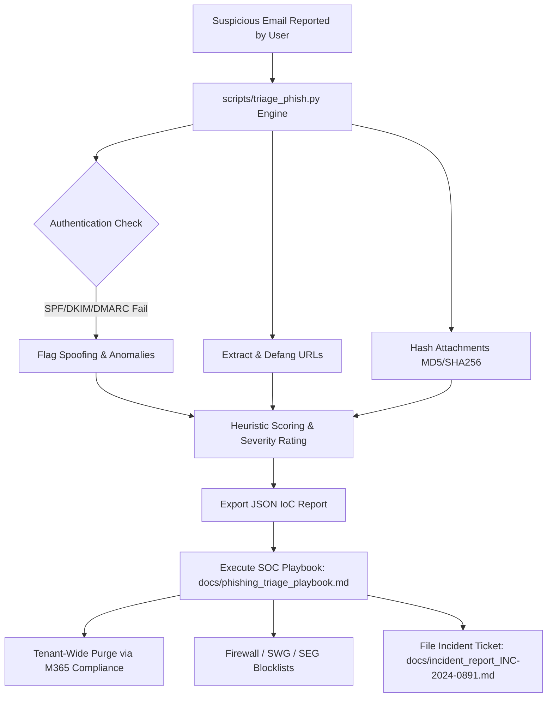

# Phishing Email Triage & SOC Incident Investigation Lab

[](#)
[](#)
[](#)

A practical, hands-on Security Operations Center (SOC) investigation lab simulating an end-to-end triage of a targeted spear-phishing attack. This project includes raw `.eml` attack artifacts, an automated Python IOC parsing and heuristic engine, an enterprise incident response playbook, and a completed Tier-1/Tier-2 investigation report.

---

## 📌 Project Overview & Objectives

In modern enterprise environments, phishing remains the #1 initial access vector (MITRE ATT&CK `T1566`). The goal of this project is to simulate real-world SOC analyst workflows:
1. **RFC 822 Header & Authentication Inspection:** Verify SPF, DKIM, and DMARC alignment, trace MTA relay hops, and extract the originating sender IP.
2. **Defanging & Threat Extraction:** Extract links and body content, defanging all IoCs to ensure operational safety.
3. **Payload Hashing & Classification:** Extract embedded attachments and compute cryptographic checksums (MD5, SHA-256) for sandbox detonation and threat intelligence correlation.
4. **Scoping & Enterprise Containment:** Map out containment procedures (Exchange Online message trace, tenant-wide email purge, IP/domain perimeter blocklists, and Active Directory credential revocation).

---

## 🏗️ Investigation Architecture & Workflow



---

## 📁 Repository Structure

```text
03-Phishing-Email-Triage/
├── samples/
│   └── urgent_payroll_phish.eml       # Realistic RFC 822 spear-phishing sample
├── scripts/
│   └── triage_phish.py                # Automated SOC triage & IoC extractor tool
├── docs/
│   ├── phishing_triage_playbook.md    # Standard Operating Procedure (SOP) & SLAs
│   ├── incident_report_INC-2024-0891.md # Complete SOC Incident Investigation Ticket
│   └── sample_triage_output.json      # Structured JSON IoC export generated by tool
└── README.md                          # Project documentation and portfolio guide
```

---

## 🚀 Quickstart & Usage

### 1. Requirements
* Python 3.8+ (Uses standard libraries; no external `pip` dependencies required).

### 2. Run the Automated Triage Engine
To analyze the sample email and display the terminal summary:

```bash
python3 scripts/triage_phish.py --file samples/urgent_payroll_phish.eml
```

### 3. Export Structured IoCs to JSON
To generate a machine-readable JSON report for ingestion into a SIEM or ticketing platform:

```bash
python3 scripts/triage_phish.py \
  --file samples/urgent_payroll_phish.eml \
  --output docs/sample_triage_output.json
```

### 4. Safely Extract Embedded Attachments
To dump attachments into an isolated quarantine folder without detonating them:

```bash
python3 scripts/triage_phish.py \
  --file samples/urgent_payroll_phish.eml \
  --dump-attachments ./quarantine/
```

---

## 📊 Sample Terminal Output

```text
======================================================================
           SOC PHISHING TRIAGE & INVESTIGATION REPORT
======================================================================

VERDICT:       MALICIOUS (High Confidence Phish)
SEVERITY:      HIGH / P1
RISK SCORE:    100/100

[+] Header Summary:
    From:       HR Payroll Department <payroll-noreply@microsoft-online-updates.xyz>
    Reply-To:   HR Helpdesk Support <collector-harvest@proton.me>
    To:         john.doe@enterprise-corp.com
    Subject:    [ACTION REQUIRED] IMMEDIATE REVIEW: Q3 Bonus Payout & Tax Withholding Verification
    Date:       Thu, 03 Oct 2024 08:14:22 -0400
    Mailer:     PHPMailer 6.5.0 (https://github.com/PHPMailer/PHPMailer)

[+] Authentication & Network Origin:
    Origin IP:  185[.]220.101[.]42
    SPF:        FAIL
    DKIM:       FAIL
    DMARC:      FAIL

[+] Threat Triggers & Anomalies:
    [!] SPF verification failed (Sender IP not permitted for domain)
    [!] DKIM signature validation failed or forged
    [!] DMARC alignment failed
    [!] Header mismatch: From domain (microsoft-online-updates.xyz) differs from Reply-To (proton.me)
    [!] High urgency headers detected (X-Priority: 1 / High)
    [!] Psychological urgency keywords detected: immediate review, action required, bonus payout
    [!] Suspicious external TLD found in embedded URL: hxxps://auth-office365-verify[.]online/...
    [!] High-risk attachment extension detected: Q3_Bonus_DirectDeposit_Form.html.zip

[+] Extracted Indicators of Compromise (IoCs):
    Defanged URLs (1):
      - hxxps://auth-office365-verify[.]online/login[.]php?session_id=8923a1ef90&email=john[.]doe@enterprise-corp[.]com
    Attachments (1):
      - File:   Q3_Bonus_DirectDeposit_Form.html.zip (287 bytes)
        SHA256: 2ad72858d85581963e10c391fca6da0e9fa552868c293110d7e840b172e3b4cd
        MD5:    fa9224cc6c58ba0150ee251ff791b6a4

[+] Recommended SOC Containment Actions:
    [x] Perimeter Firewall: Block inbound traffic from originating IP 185[.]220.101[.]42
    [x] Email Gateway (SEG): Add sender domain/address to global blocklist
    [x] Microsoft 365 Defender: Execute message trace and soft-delete/purge identical Subject/Message-ID across all tenant mailboxes
    [x] Proxy / DNS: Block domain resolution for extracted malicious URLs on Secure Web Gateway (SWG)
    [x] Identity / IAM: Check Azure AD / Okta sign-in logs for target user; enforce immediate password reset & revoke active OAuth refresh tokens if clicked

======================================================================
```

---

## 🛡️ Enterprise Documentation Highlights

* **[SOC Phishing Playbook (SOP)](docs/phishing_triage_playbook.md):** Complete operational guidelines for Tier 1 analysts covering intake, URL analysis, sandbox checks, SIEM threat scoping, and tenant-wide containment.
* **[Incident Investigation Report (INC-2024-0891)](docs/incident_report_INC-2024-0891.md):** Fully completed enterprise security ticket with executive summary, MITRE ATT&CK matrix, timeline, and mitigation strategies.

---


